 

<samp>── 03 · NOW</samp>

## Currently **building.**

🔭 &nbsp;Mobile products people open every day 
🧠 &nbsp;Brain-computer interfaces and bio-signal interaction 
🌱 &nbsp;Behavioral analytics and product strategy 
📍 &nbsp;Open to collaboration on HCI, mobile and AI

 

 

<samp>── 04 · SELECTED WORK</samp>

## Shipped, tested, **used.**

**[Ehliyet Rehberim](https://github.com/ummugulsunn/ehliyet-rehberim)** — Mobile Product & UX 
Driving-education app, live on Google Play with a **5.0 rating**. Every flow designed from scratch, used daily by real exam candidates. 
  

**[Neurotech](https://github.com/ummugulsunn/neurotech-blink-detection)** — HCI & Bio-Signals 
Touchless interaction prototype on real-time EEG. A blink becomes a command. 
  

**[FlowStateAI](https://github.com/ummugulsunn/FlowStateAI)** — AI & Behavior Analysis 
Decodes how people really use a system from keystroke dynamics. 
 

 

<samp>── 05 · STACK</samp>

## Built **with.**

 

<samp>── 06 · GITHUB</samp>

## In **numbers.**

  
  

  

 

