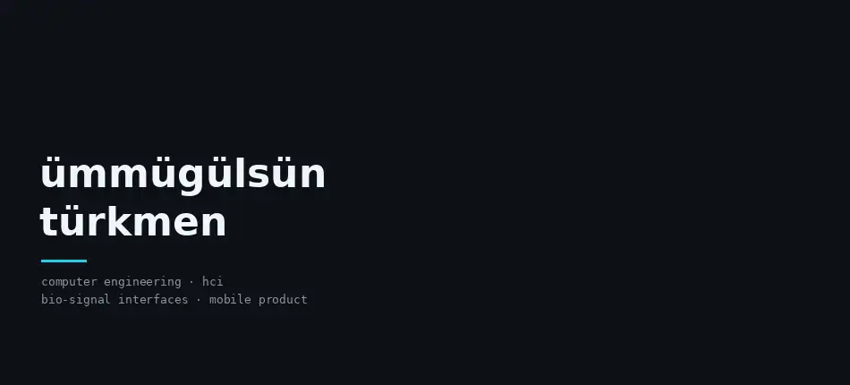
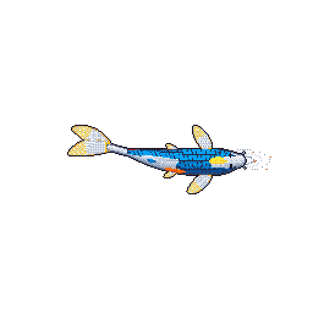

<samp>computer engineering · hci · bio-signal interfaces · mobile product</samp>

<samp><a href="https://linkedin.com/in/ummugulsunturkmen">linkedin</a> &nbsp;·&nbsp; <a href="https://ummugulsun.me">portfolio</a> &nbsp;·&nbsp; <a href="mailto:ummugulsunturkmen@gmail.com">email</a></samp>

I build user-centric apps and explore bio-signal interfaces. Computer Engineering student with a product-first mindset: I shipped a **5.0-rated app on Google Play** and I am prototyping **touchless interaction with EEG sensors**.

### Selected work

<samp>01</samp> &nbsp; **[Stremio Dual Subtitles](https://github.com/ummugulsunn/stremio-dual-subtitles)** — two subtitle languages at once, for language learners. 39 ★ · [live](https://stremio-dual-subtitles.vercel.app) 
<samp>02</samp> &nbsp; **[Ehliyet Rehberim](https://github.com/ummugulsunn/ehliyet-rehberim)** — driving-license exam prep for Turkey. Flutter · Google Play · 5.0 rating 
<samp>03</samp> &nbsp; **[Neurotech Blink Detection](https://github.com/ummugulsunn/neurotech-blink-detection)** — real-time EEG: a blink becomes a command. Python · Arduino 
<samp>04</samp> &nbsp; **[Automata Theory Simulator](https://github.com/ummugulsunn/automata-theory-simulator)** — DFA, NFA, PDA and Turing machines, step by step. [live](https://ummugulsunn.github.io/automata-theory-simulator/)

also: [toshiba-tv](https://github.com/ummugulsunn/toshiba-tv) (mirror a Mac to a non-Android TV) · [webos-magic-caster](https://github.com/ummugulsunn/webos-magic-caster) (LG webOS remote & caster) · [GestureGroove](https://github.com/ummugulsunn/gesture-groove-imageprocessing-final-project) (music with hand gestures) · [prayertimer](https://github.com/ummugulsunn/prayertimer) (macOS menu-bar app)

Python · Dart · JavaScript · C++ · Flutter · Node.js · Arduino

### Streak

   
  

Open to collaboration on HCI, mobile product and AI projects.

<samp>the lilies are drawn in code, one character at a time · the koi grows with my commits, by <a href="https://github.com/yalongwastaken/git-koi">git-koi</a></samp>

