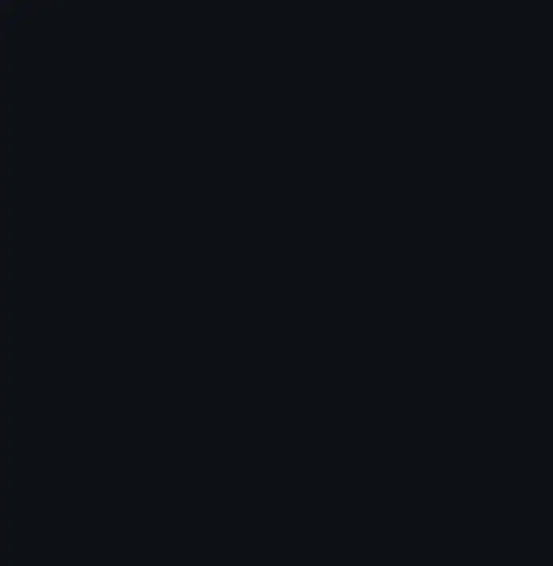

<samp><a href="https://linkedin.com/in/ummugulsunturkmen">linkedin</a> &nbsp;·&nbsp; <a href="https://ummugulsun.me">portfolio</a> &nbsp;·&nbsp; <a href="mailto:ummugulsunturkmen@gmail.com">email</a></samp>

Computer Engineering student with a product-first mindset. I take raw signals — EEG, keystrokes, behavior — and turn them into interfaces people actually use. Shipped a **5.0-rated app on Google Play**; currently prototyping **touchless interaction with EEG sensors**.

### Selected work

<samp>01</samp> &nbsp; **[Stremio Dual Subtitles](https://github.com/ummugulsunn/stremio-dual-subtitles)** 
Two subtitle languages at once, for language learners. 37 ★ · [live](https://stremio-dual-subtitles.vercel.app)

<samp>02</samp> &nbsp; **[Ehliyet Rehberim](https://github.com/ummugulsunn/ehliyet-rehberim)** 
Driving-license exam prep for Turkey. Flutter · Google Play · 5.0 rating

<samp>03</samp> &nbsp; **[Neurotech Blink Detection](https://github.com/ummugulsunn/neurotech-blink-detection)** 
Real-time EEG: a blink becomes a command. Python · Arduino

<samp>04</samp> &nbsp; **[Automata Theory Simulator](https://github.com/ummugulsunn/automata-theory-simulator)** 
DFA, NFA, PDA and Turing machines, step by step. [live](https://ummugulsunn.github.io/automata-theory-simulator/)

Python · Dart · JavaScript · C++ · Flutter · Node.js · Arduino

 

  

<samp>koi, lilies and the cat are drawn in code, one character at a time.</samp>

