<div align="center">


<br>

[](https://linkedin.com/in/ummugulsunturkmen)
[](https://ummugulsun.me)
[](mailto:ummugulsunturkmen@gmail.com)

</div>

<br>



<br>

### About

Computer Engineering student with a product-first mindset. I don't just write code — I design experiences. From shipping a 5-star rated app on Google Play to prototyping touchless interfaces with EEG sensors, every project starts and ends with the user.

Currently exploring the intersection of **Human-Computer Interaction**, **behavioral analysis**, and **mobile product development**.

---

### Tech Stack

**Languages & Frameworks**


**Tools & Platforms**


**Product & Design**


---

### Featured Projects

**Ehliyet Rehberim** — Mobile Product & UX

Solo-developed driving education app, live on Google Play with a **5.0 rating**. Designed every user flow from scratch, defined UI principles, and shipped a product that real users depend on daily to prepare for their driving license exams.


[](https://github.com/ummugulsunn/ehliyet-rehberim)

<br>

**Neurotech** — HCI & Bio-Signals

Touchless interaction prototype powered by real-time EEG signal processing. An R&D project exploring how brain-computer interfaces can redefine human-computer interaction — no screens, no touch, just thought.


[](https://github.com/ummugulsunn/neurotech-blink-detection)

<br>

**FlowStateAI** — AI & Behavior Analysis

Automation and analysis tool that decodes user behavior through keystroke dynamics. Combines Python-driven data analysis with behavioral pattern recognition to understand how people truly interact with systems.


[](https://github.com/ummugulsunn/FlowStateAI)

---

### GitHub Analytics

<div align="center">
  
  
</div>

<br>

<div align="center">
  
</div>

<br>

<div align="center">

```
> open to collaboration on HCI, mobile product, and AI projects_
```

</div>
